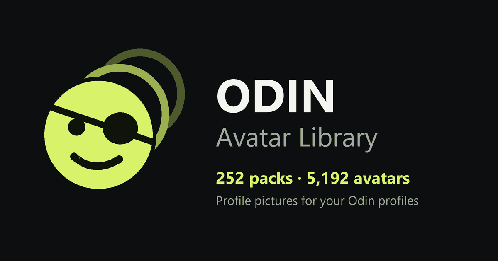

<p align="center">
  <a href="https://avatars.italianodoc.eu"></a>
</p>

<h1 align="center">Odin Avatar Library</h1>

<p align="center">
  An unofficial community library of profile pictures for <a href="https://odinapp.dev/">Odin</a>.<br>
  <a href="https://avatars.italianodoc.eu"><strong>Open the library</strong></a>
  ·
  <a href="https://avatars.italianodoc.eu/guide">Installation guide</a>
  ·
  <a href="https://avatars.italianodoc.eu/request">Request a pack</a>
</p>

---

## What you get

- **252 packs, 5,192 avatars**, 1,674 of them animated, from eleven platforms: Netflix, Crunchyroll, Prime Video, Disney Plus, Apple TV, PlayStation, Steam and more.
- **Search by character.** Type a name and jump straight to that picture, whichever pack it is in.
- **Take only what you want.** Collect packs in a selection and download them as one ZIP, already laid out the way Odin expects. Or copy the whole library to your pCloud in one step.
- **Try before you download.** Put up to five avatars on a preview of Odin's "Who's Watching" screen.
- **A guide that follows the app.** Seven short chapters, from saving the files to choosing a profile picture, with a troubleshooting page for when something does not load.

## How it works

The website is only a catalog: it stores no images. Thumbnails, manifests and ZIP files are served by a public pCloud share, and Odin reads the packs from your own storage over WebDAV.

```
this website ──▶ pCloud share ──▶ your storage (pCloud or any WebDAV) ──▶ Odin
   browse           download              keep the files                 add packs
```

It never asks for a password, and it has no accounts, analytics or advertising. Your selection and your preview stay in your browser.

## Requests and corrections

Missing a show? A wrong name or a broken picture? Use the [request page](https://avatars.italianodoc.eu/request) or [open an issue](../../issues/new/choose). The request page checks whether the pack already exists and fills in the issue for you.

Trouble connecting Odin to pCloud is usually solved by the [help page](https://avatars.italianodoc.eu/help).

## Project structure

| Path | Contents |
| --- | --- |
| `src/pages` | One file per page: catalog, pack, selection, preview, guide, help |
| `src/components` | Shared pieces: layout, thumbnails and lightbox, pack cards, phone illustrations |
| `src/lib` | pCloud addresses, selection, share links, preview profiles |
| `src/content` | The text of the guide and the help page |
| `public/data` | The catalog, generated; do not edit by hand |
| `scripts` | Catalog refresh, link-preview image, page prerendering |
| `audit` | The source listing the catalog is built and tested from |

Built with React, TypeScript and Vite.

## Disclaimer

This project is not affiliated with, endorsed by or operated by Odin, pCloud or the owners of any depicted characters. Artwork and trademarks belong to their respective owners. If you own some of this artwork and want it removed, [open an issue](../../issues/new/choose).
